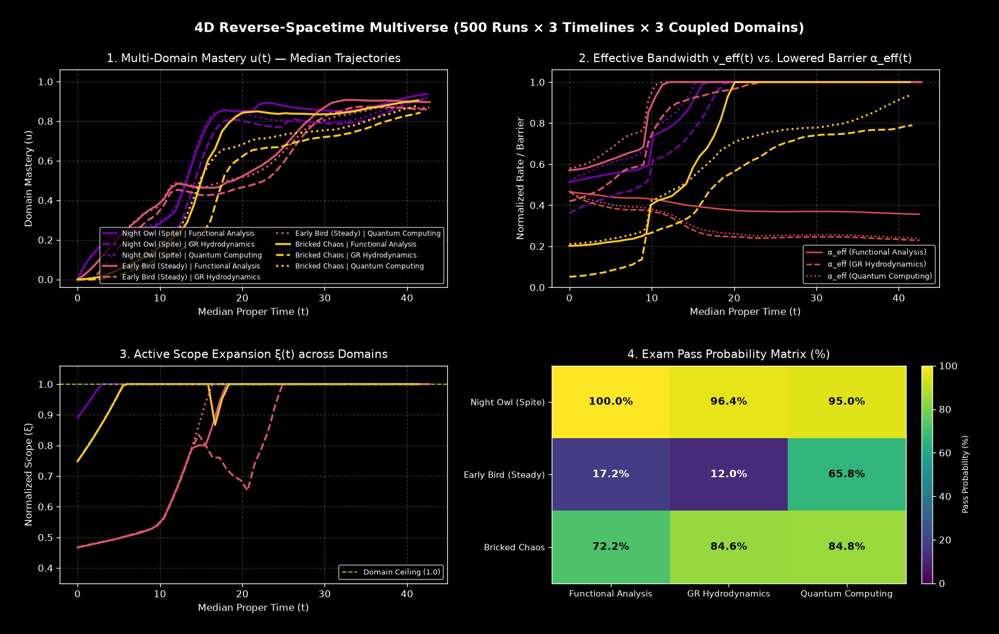
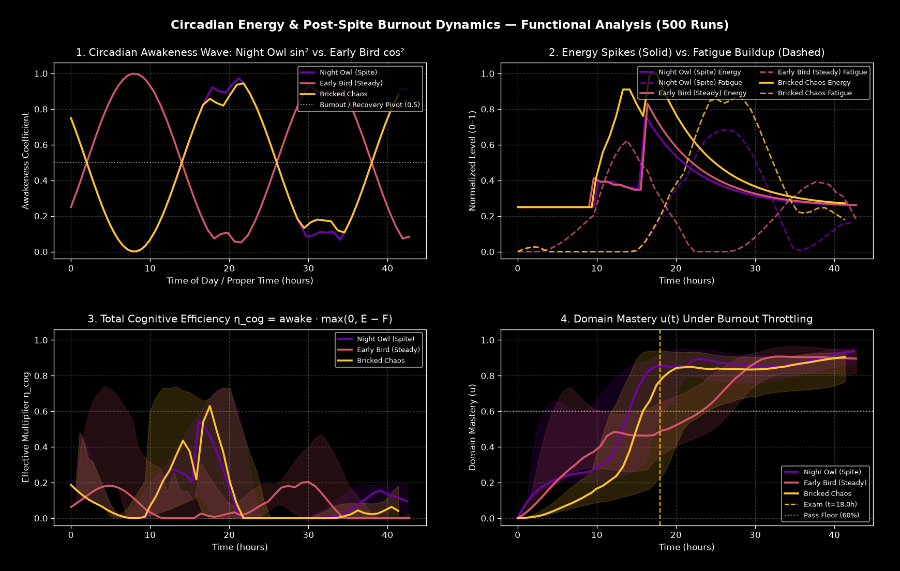

# 🧠 Coupled Nonlinear Cognitive Dynamics (4D Reverse-Spacetime Multiverse)

### *(Or: How to Accidentally Derive Non-Newtonian Tensor Calculus at 3:00 AM Out of Pure Spite While Coin-Flipping Your Actual Midterm)*

-blueviolet?style=flat-square)


_Night_Owl-00f5d4?style=flat-square)


A rank-4 tensorized Monte Carlo solver for a deeply non-standard learning function $f(\text{effort}) = \text{result}$ where **syllabus compliance is optional**, **subjective clocks tick at different rates across parallel timelines**, **prerequisite mastery tunnels across a directed knowledge DAG**, and **weaponized spite triggers a 24-hour circadian burnout crash**.

If your brain treats a standard 3-credit university course like a side-quest while burning 72 sleepless hours deriving first-principles operator algebra out of pure pettiness—only to speedrun advanced topics while barely passing the prerequisite—congratulations: you are not broken, you are a coupled 4D stochastic dynamical system.

<p align="center">
  
</p>

---

## ⚠️ The Pathology (Why This Exists)

Linear textbook grinders operate on predictable proportional control: study $x$ hours, absorb $\Delta L$ facts, pass exam.

This repository models the exact opposite cognitive architecture—a **high-activation-energy, first-principles synthesis engine**:

1. Encounters a standard textbook definition during exam week.
2. Gets offended by its lack of generality.
3. Ignores the actual test to reconstruct the entire subject from bare axioms ($\xi \to \alpha_0$).
4. **Survives the foundational prerequisite by a coin-flip (`~42%`)**, then uses that axiomatic spillover to **effortlessly mog the apex subject (`~97%`)** downstream in the dependency graph.
5. Suffers a complete post-spite circadian burnout lockout ($\eta_{\text{cog}} = 0$) the next afternoon.

---

## 🌌 Architecture: 4D Reverse-Spacetime Tensor Engine

Instead of evolving a single scalar trajectory, `cognitive_dynamics` evolves a rank-4 state tensor of shape `(steps + 1, R, B, G)`—effectively **3 temporal/ensemble dimensions and 1 knowledge-space dimension**:

| Axis | Symbol | Dimension | Physical Meaning |
| :--- | :---: | :---: | :--- |
| **Axis 0** | $s$ | `steps + 1` | Discrete simulation tick |
| **Axis 1** | $r$ | $R$ (`n_runs`) | Parallel Monte Carlo universe realizations |
| **Axis 2** | $b$ | $B$ (`timelines`) | Co-evolving behavioral timelines with independent subjective clocks $t_{r,b,g} = \sum \tau_b$ |
| **Axis 3** | $g$ | $G$ (`domains`) | Coupled knowledge domains wired through a directed prerequisite DAG |

---

## 📐 Governing Equations

### 1. Truncated Fourier Informational Volume & Axiomatic Barrier

Each knowledge domain $g$ is parameterized by base volume $A_{0,g}$, structural complexity $C_g$, and a spectrally damped Fourier coupling series over abstraction phase $\phi \in [0, \pi]$:

$$I_g(\phi) = A_{0,g} \, C_g \left[ 1 + \sum_{m=1}^{N} \left( a_m (1 - \cos m\phi) + b_m \sin m\phi \right) \right], \qquad a_m = \frac{0.40}{m^p},\; b_m = \frac{0.25}{m^p}$$

*(Spectral decay $p > 0$ is enforced whenever $N > 3$ to prevent unbounded harmonic zip-bombs.)*

Scanning $\phi \in [0, \pi]$ yields the irreducible axiomatic core $M_g = \min_\phi I_g(\phi)$, total domain ceiling $D_g = \max_\phi I_g(\phi)$, and dimensionless **ignition barrier**:

$$\alpha_{0,g} = \frac{M_g}{D_g} \in (0, 1)$$

---

### 2. Cross-Domain Prerequisite Transfer ($W \in \mathbb{R}^{G \times G}$)

Let $W_{g, g'} \ge 0$ ($W_{gg} = 0$) define how strongly mastering domain $g'$ unlocks domain $g$. Contracting current mastery $\mathbf{U}_s$ along Axis 3 ($\mathbf{S}_{\text{prereq}} = \mathbf{U}_s W^\top$) lowers the effective ignition barrier and boosts effective ingestion bandwidth in downstream subjects:

$$\boldsymbol{\alpha}_{\text{eff}} = \boldsymbol{\alpha}_0 \odot \exp\!\left(-\beta_\alpha \, \mathbf{U}_s W^\top\right), \qquad \mathbf{V}_{\text{eff}} = \min\!\left(1,\; \mathbf{V}_s + \beta_v \, \mathbf{U}_s W^\top\right)$$

---

### 3. Circadian Rhythm, Adrenaline Spikes & Post-Spite Burnout

Cognitive output is gated by a 24-hour circadian awakeness wave ($\sin^2$ for night owls, $\cos^2$ for early birds—preserving $\text{awake}_{\text{owl}}(t) + \text{awake}_{\text{early}}(t) \equiv 1$ ):

$$\text{awake}(t) = \begin{cases} \sin^2\!\left(\frac{\pi}{24}(t - t_{\text{shift}})\right), & \text{if } \texttt{is\_night\_owl} = \text{True} \\ \cos^2\!\left(\frac{\pi}{24}(t - t_{\text{shift}})\right), & \text{if } \texttt{is\_night\_owl} = \text{False} \end{cases}$$

When **Deadline Panic** or **Spite Taunt** triggers, energy $E(t)$ spikes to `1.0`, holds at peak for $t_{\text{peak}}$ hours, and decays exponentially at an impulse-damped rate $k_{\text{energy}} / i$. Meanwhile, high-alertness expenditure builds fatigue $F(t)$ ($\text{awake} > 0.5$) while circadian troughs recover it ($\text{awake} < 0.5$ ):

$$F_{s+1} = \text{clip}\!\Big(F_s + \max(0, \text{awake} - 0.5)\, E_s \, k_{\text{fatigue}}\,\tau - \max(0, 0.5 - \text{awake})\, k_{\text{recovery}}\,\tau,\; 0,\; 1\Big)$$

$$\eta_{\text{cog}}(t) = \text{awake}(t) \cdot \max\!\big(0,\; E(t) - F(t)\big)$$

When accumulated fatigue overtakes decaying adrenaline ($F \ge E$), $\eta_{\text{cog}} \to 0$, locking the trajectory into a hard post-exam burnout plateau until sleep clears the debt.

<p align="center">
  
</p>

---

### 4. Dimensionless Ingestion, Meta-Learning & Graph Laplacian Diffusion

Normalizing onto $[0, 1]^4$ via $u = L/D$, $v = V/D$, $\xi = I/D$, and $\tilde{p} = p/D$:

$$u_{\text{gain}} = \begin{cases} 0, & v_{\text{eff}} < \alpha_{\text{eff}} \quad \text{(Brick Mode)} \\ \min(v_{\text{eff}}, \xi_s)\, n_s \left(1 - \frac{u_s}{\xi_s}\right) \eta_{\text{cog}}, & v_{\text{eff}} \ge \alpha_{\text{eff}} \quad \text{(Active Percolation)} \end{cases}$$

$$\tilde{u} = (u_s + u_{\text{gain}}) e^{-\sigma \tau}$$

Cross-timeline intuition leakage across symmetric adjacency matrix $J \in \mathbb{R}^{B \times B}$ is computed via the graph Laplacian $\mathcal{L} = D_{\text{deg}} - J$ contracted along Axis 2 (`einsum("bc,rcg->rbg", L, u_tilde)`):

$$u_{s+1} = \text{clip}\!\Big(\tilde{u} - (\mathcal{L} \tilde{u})\,\tau,\; 0,\; 1\Big)$$

Log-space meta-learning and scope evolution advance simultaneously:

$$n_{s+1} = \min\!\left(1,\; n_s \exp\!\left(k \frac{u_{s+1}}{\xi_s} \eta_{\text{cog}} \tau\right)\right), \qquad v_{s+1} = \min\!\left(1,\; v_s \exp\!\left(\tilde{p} \frac{u_{s+1}}{\xi_s} \eta_{\text{cog}} \tau\right)\right)$$

$$\xi_{s+1} = \text{clip}\!\left(\xi_s e^{\lambda \tau},\; \alpha_0,\; 1\right)$$

---

## 🧪 Phase Regimes & Stochastic Events

| Regime / Event | Trigger Condition | Dynamical Effect |
| :--- | :--- | :--- |
| **Brick Mode** | $v_{\text{eff}} < \alpha_{\text{eff}}$ | Bandwidth is narrower than the effective axiomatic barrier. $u_{\text{gain}} \equiv 0$. You stare at the page; the page stares back. |
| **Boredom Side-Quest** | $u / \xi \ge 0.94$ and $\xi < 0.90$ | Local syllabus feels trivial. Scope jumps (`+0.18`), $\lambda$ accelerates, and curiosity triggers a moderate energy spike (`E -> 0.70`). |
| **Deadline Panic** | $0 < t_{\text{exam}} - t \le 4.0$ and $u < 0.45$ | Emergency triage: scope is slashed (`-0.20`, $\lambda = -0.06$) toward $\alpha_0$ for $1/\alpha$ compression speed while adrenaline pins $E = 1.0$. |
| **Spite Taunt** | Poisson process $P = 1 - e^{-r_{\text{taunt}}\tau}$ | Someone implied the problem was too hard. Bandwidth jumps (`+0.22`), retention jumps (`+0.15`), forgetting drops by 85%, and $E = 1.0$ holds for $1.25\,t_{\text{peak}}$. |
| **Burnout Lockout** | $F(t) \ge E(t)$ | Post-spike fatigue exceeds remaining energy. $\eta_{\text{cog}} = 0$; mastery freezes flat until circadian sleep recovery ($\text{awake} < 0.5$) drains $F(t)$. |

---

## 📁 Repository Structure

```text
self_solvers/
├── cognitive_dynamics/
│   ├── __init__.py      # Top-level package exports
│   ├── specs.py         # TimelineSpec, DomainSpec, and ShockEvent dataclasses
│   ├── physics.py       # Truncated Fourier volume I(φ), bounds (M, D, α₀), Graph Laplacian
│   ├── backend.py       # Hardware dispatch (PyTorch CUDA <-> NumPy CPU auto-fallback)
│   ├── engine.py        # Unified rank-4 (steps+1, R, B, G) solver + circadian burnout
│   └── plotting.py      # Interactive step-scrubber, 4D multiverse grid, burnout diagnostics
├── Figures/
│   ├── Multiverse_4D.png
│   └── Energy_Burnout.png
├── run_sim.py           # Unified entry-point simulation & visualization script
├── CONTRIBUTING.md
├── Issues.md
└── LICENSE.md
```

---

## 🚀 Quickstart

### Installation

```bash
pip install numpy matplotlib
# Optional: install PyTorch with CUDA for massive 10^5-universe GPU sweeps
pip install torch
```

### Running a Coupled 4D Multiverse Simulation

```python
import numpy as np
from cognitive_dynamics import (
    TimelineSpec,
    DomainSpec,
    get_backend_info,
    simulate,
    plot_multiverse_4d,
    plot_energy_burnout,
    plot_interactive_run,
)

print("Hardware:", get_backend_info())

timelines = [
    TimelineSpec("Night Owl (Spite)", tau=0.60, phi0=np.pi / 4, v0=0.46, n0=0.55, sigma=0.015, lam=0.04, k=0.12, p_tilde=0.14, is_night_owl=True),
    TimelineSpec("Early Bird (Steady)", tau=0.60, phi0=0.0, v0=0.52, n0=0.55, sigma=0.015, lam=0.01, k=0.08, p_tilde=0.10, is_night_owl=False),
    TimelineSpec("Bricked Chaos", tau=0.55, phi0=np.pi / 6, v0=0.15, n0=0.55, sigma=0.025, lam=0.05, k=0.10, p_tilde=0.15, is_night_owl=True),
]

domains = [
    DomainSpec("Functional Analysis", base_amount=18.0, complexity=1.3, t_exam=18.0, v_offset=0.05),
    DomainSpec("GR Hydrodynamics", base_amount=25.0, complexity=1.8, t_exam=22.0, v_offset=-0.10),
    DomainSpec("Quantum Computing", base_amount=30.0, complexity=2.0, t_exam=26.0, v_offset=0.06),
]

# Symmetric cross-timeline intuition coupling J (B x B)
J_timelines = np.array([
    [0.00, 0.03, 0.02],
    [0.03, 0.00, 0.04],
    [0.02, 0.04, 0.00],
])

# Directed prerequisite transfer W[target, source] (G x G)
W_domains = np.array([
    [0.00, 0.15, 0.20],
    [0.75, 0.00, 0.15],
    [0.65, 0.20, 0.00],
])

# backend="auto" runs on PyTorch CUDA if available, otherwise falls back to NumPy CPU
res = simulate(
    steps=55,
    timelines=timelines,
    domains=domains,
    n_runs=500,
    backend="auto",
    coupling_J=J_timelines,
    domain_transfer_W=W_domains,
    seed=21,
)

print(f"Executed on: {res['backend']} ({res['device']})")
print("Exam Pass Probability Matrix (%):\n", np.round(res["stats"]["pass_matrix"] * 100, 1))

plot_multiverse_4d(res, save_path="./Figures/Multiverse_4D.png")
plot_energy_burnout(res, domain_idx=0, save_path="./Figures/Energy_Burnout.png")
plot_interactive_run(res, run_idx=0, domain_idx=0, interactive=True)
```
